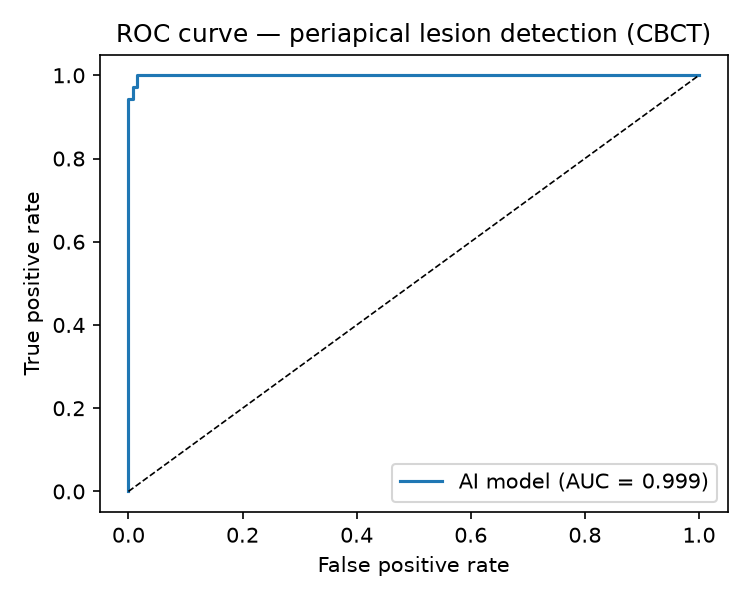

# dental-ai-biostats-demo

Reproducible biostatistics cases for validating AI diagnostics in dentistry,
built against the requirements typically expected in CE/FDA-style clinical
evaluation of medical AI software.

Everything runs locally on synthetic data — no real patient data, no external
services.

## What's inside

| File | Language | What it demonstrates |
|------|----------|----------------------|
| `01_diagnostic_accuracy.py` | Python | Diagnostic-accuracy validation of an AI model vs. a physician on paired CBCT reads |
| `02_study_design.R` | R | Sample-size calculation for a clinical study protocol + paired analysis of reading-time savings |
| `data_qc.sql` | SQL | Data-integrity checks on the validation-study table before analysis |
| `roc_curve.png` | — | ROC curve produced by `01_diagnostic_accuracy.py` |
| `requirements.txt` | — | Python dependencies |

## Case 1 — AI vs. physician diagnostic accuracy (Python)

`01_diagnostic_accuracy.py` simulates 200 teeth on CBCT scans with an
expert-consensus reference label and computes:

- Sensitivity and specificity with 95% Wilson confidence intervals
- Cohen's kappa (agreement with reference) for the AI model and for a
  physician reading without AI
- ROC-AUC of the model's probability output
- McNemar's exact test — is the difference in accuracy between AI and
  physician statistically significant on the *same* scans?

Run:

```bash
pip install numpy pandas scikit-learn statsmodels matplotlib
python 01_diagnostic_accuracy.py
```

### Results (seed = 42, n = 200 teeth)

| Method | Sensitivity (95% CI) | Specificity (95% CI) | Cohen's κ |
|--------|----------------------|----------------------|-----------|
| AI model | 0.972 (0.903–0.992) | 0.992 (0.957–0.999) | 0.967 |
| Physician (no AI) | 0.803 (0.696–0.879) | 0.876 (0.808–0.922) | 0.675 |

- **ROC-AUC:** 0.999
- **McNemar exact p-value:** < 0.0001
- Paired correctness: AI and physician agree on 171/200 cases; the AI is
  correct where the physician errs on 28 cases vs. 3 the other way.



**Interpretation:** McNemar p < 0.05 *and* the lower bound of the AI
sensitivity 95% CI (0.903) exceeds the clinical threshold of 0.85 — the model
shows statistically significant superiority over baseline diagnostics. Both
conditions are required: a significant p-value alone does not establish
clinical adequacy.

## Case 2 — Study design and reading-time analysis (R)

`02_study_design.R` covers two things:

**A. Sample-size calculation** for confirming AI sensitivity in a clinical
protocol:

- One-sided test: H0 Se ≤ 0.85 vs H1 Se = 0.92, α = 0.025, power = 80%
- Conversion to total teeth via pathology prevalence
- Design-effect correction for clustering (multiple teeth per patient — a
  classic trap in dental statistics) using ICC
- Attrition allowance for unreadable scans

**B. Paired analysis of reading time** (n = 40 scans):

- Shapiro-Wilk normality check on the paired differences
- Paired t-test with 95% CI on mean time saved
- Wilcoxon signed-rank test as the non-parametric counterpart
- Cohen's d effect size

Run:

```r
Rscript 02_study_design.R
```

Expected output:

```
Positive cases needed: ...
Teeth after clustering correction (DE=1.20): ...
Total patients (with 10% attrition): ...

Shapiro-Wilk p = ...
Mean time saved: ... s (95% CI: ...-...), p = ...
Cohen's d = ... | Wilcoxon p = ...
```

## Bonus — Data QC before analysis (SQL)

`data_qc.sql` flags, per `scan_id`, in the `cbct_validation_study` table:

- duplicate rows for the same scan
- missing expert labels or missing AI probabilities
- AI probabilities outside [0, 1]
- implausible reading times (≤ 0 s or > 1 h)

Run against any SQL database hosting the study table — any returned row is a
data problem to fix before analysis.

## Why these cases

They map directly to what a biostatistics / clinical-data role at a
medical-AI company actually does:

- computing clinical performance metrics with proper uncertainty
  quantification (confidence intervals, not just point estimates)
- agreement statistics vs. expert reference (kappa)
- statistically valid comparison of model vs. human baseline on paired data
  (McNemar, paired t-test / Wilcoxon)
- study design awareness: sample size, clustering, attrition, data QC

All scripts are deterministic (fixed seeds), so results reproduce exactly.
